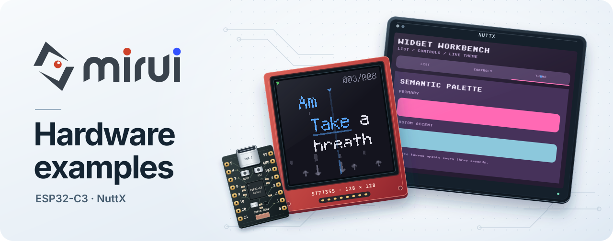
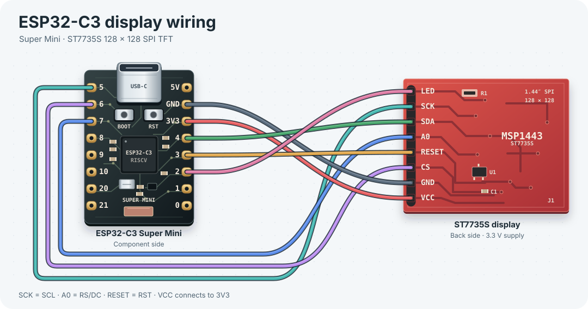

<picture>
  <source media="(prefers-color-scheme: dark)" srcset="assets/readme-hero-dark.svg" />
  
</picture>

[Mirui](https://github.com/W-Mai/mirui) · [Examples](#examples) · [Wiring](#esp32-c3-wiring) · [Quick start](#esp32-c3-quick-start) · [Demos](#demo-features)

## Examples

- **[ESP32-C3 Animation](examples/esp32c3-animation/)** · Gallery demos, dirty-region rendering, input timelines, curve text, effects and performance probes. [Build and flash](#esp32-c3-quick-start).
- **[ESP32-C3 Chord Prompter](examples/esp32c3-chord-prompter/README.md)** · Browser BLE song uploads, chord prompting and beat-aligned controls.
- **[NuttX Widgets](examples/nuttx_demo/README.md)** · Framebuffer, touch and keyboard integration with partial refresh and RGB565/RGBA8888 support. The reference target is `rv-virt:fb` with QEMU virtio-gpu.

## ESP32-C3 wiring

Both ESP32-C3 examples use a Super Mini and an MSP1443 ST7735S 128 × 128 SPI display. Open the diagram to zoom in.

[](assets/esp32c3-st7735s-wiring.svg)

<details>
<summary>Pin reference</summary>

| Display pin | ESP32-C3 | Function |
| --- | --- | --- |
| `SCK` / `SCL` | `GPIO5` | SPI clock |
| `SDA` | `GPIO4` | SPI data (MOSI) |
| `CS` | `GPIO6` | Chip select |
| `A0` / `RS/DC` | `GPIO7` | Data / command |
| `RESET` / `RST` | `GPIO3` | Display reset |
| `LED` | `GPIO2` | Backlight |
| `VCC` / `3V3` | `3V3` | 3.3 V supply |
| `GND` | `GND` | Ground |

</details>

## ESP32-C3 quick start

### 1. Install tools

- Rust nightly (edition 2024)
- Target: `rustup target add riscv32imc-unknown-none-elf`
- Flash tool: `cargo install espflash`
- PlatformIO (bootloader only): `pip install platformio`

### 2. Flash the bootloader

ESP32-C3 Super Mini (chip rev v0.4) requires a compatible bootloader with `min_chip_rev=0`. Run this once from the repository root.

```bash
(cd bootloader && pio run -t upload)
```

This installs an ESP-IDF bootloader that accepts any chip revision.

### 3. Build and flash the animation example

```bash
cd examples/esp32c3-animation
cargo build --release
espflash flash target/riscv32imc-unknown-none-elf/release/mirui-esp32c3 \
  --port /dev/cu.usbmodem1101 \
  --bootloader ../../bootloader/.pio/build/esp32c3/bootloader.bin
```

> Serial port name may vary. Use `ls /dev/cu.usb*` to find yours.

### Release optimization

The ESP32-C3 animation example uses optimization level 3, LTO, and one codegen unit for rendering throughput. This produces a larger application image than size optimization. For a size-sensitive build, run `CARGO_PROFILE_RELEASE_OPT_LEVEL=z cargo build --release` and check the generated image against the device partition size.

## Demo features

Select one `demo-*` feature with `--no-default-features`; `demo-threebody` is the default.

<details>
<summary>Available demos</summary>

| Feature | Content |
|---------|---------|
| `demo-threebody` | Animated N-body scene |
| `demo-subpixel` | Fixed-point subpixel motion |
| `demo-particles` | Particle, pulse, and bar animation |
| `demo-flipcard` | Projective 2.5D card flip |
| `demo-coverflow` | Projective cover flow |
| `demo-life` | Gallery Life with its shared view, timer, and update system |
| `demo-widgets` | Automated compact widget showcase |
| `demo-effects` | Mirror and background blur |
| `demo-kinetic` | Automated Kinetic Console |
| `demo-curve-text-compact` | Bitmap text moving along a retained curve |
| `demo-shapes` / `demo-butterfly` | Vector custom-view studies |
| `demo-typography` | Gallery Typography Lab with bundled MIRX fonts |
| `demo-interaction` | Gallery Interaction Lab with typed input handlers |

</details>

The three-body scene registers only the Style and Image views it uses. Other App scenes enable the complete widget catalog through their feature dependencies; combining them with the three-body feature preserves that registration.

`perf-fps`, `perf-trace`, `perf-plan-probe`, `frame-capture`, `fps-overlay`, and `spin` add diagnostics or optional animation behavior. Performance reports distinguish operation wall time, callback cadence and phase budgets; callback cadence is not native display refresh. `demo-hidpi-downscale` and `demo-hidpi-upscale` change the logical viewport used by the three-body demo.

### Offscreen framebuffer diagnostic

Build the UART-only diagnostic with `cargo build --release --no-default-features --features esp-test-offscreen` from `examples/esp32c3-animation`. It does not initialize the LCD or SPI peripherals. Running the firmware emits eight RGB565Swapped frames between `[FB_BEGIN]` and `[FB_END]`, with base64 `[FB]` lines and FNV-1a hashes. Form-level and Switch-only captures check state changes; clipped regions must match the corresponding full-frame pixels and leave pixels outside the clip cleared. A failed render or comparison panics instead of printing a successful completion marker. `[TEST] done` indicates all checks finished.

The diagnostic uses App preparation for text and output storage, then exercises the low-level region renderer. Its direct ECS mutations isolate raster behavior from animation and input handling; they are not the application authoring API.

The [ESP32-C3 workflow](.github/workflows/esp32c3-examples.yml) builds both release firmwares with their lockfiles and runs the offscreen diagnostic in Espressif QEMU. The runtime job requires all eight frame checks and saves the emulator and serial logs. The workflow caches Rust dependencies and checks the hashes of the emulator and flash tool archives on every run. Use the `cold` option to compare a run with cache reads and writes disabled. The SPI display and BLE radio use physical device checks.

### Physical LCD check

Build the animation with `cargo build --release --locked --features perf-fps`, then flash it using the [normal board instructions](#3-build-and-flash-the-animation-example). From the repository root, run the check with `pyserial` installed in the test environment and the port of the board being tested:

```bash
python3 ci/test-esp32c3-device.py lcd /dev/cu.usbmodem1101
```

The check requires two tick reports with completed SPI flushes. Check the physical LCD for three moving images and clean edges. The [Chord Prompter BLE check](examples/esp32c3-chord-prompter/README.md#physical-ble-check) uses the same board with its own firmware.

## Target status

| Target | Status | Notes |
|--------|--------|-------|
| ESP32-C3 Super Mini + ST7735S | Hardware verified | Complete board wiring and flash flow live in `esp32c3-animation` |
| NuttX `rv-virt:fb` | QEMU verified | Functional validation target; cross-architecture QEMU timing is not a performance baseline |
| ESP32-S3, RP2040, STM32 | Portable architecture, unverified here | Requires a board-specific allocator, clock, input, framebuffer flush, and panel driver |

## Performance

- **Full-screen refresh**: 60fps (SPI 26MHz bottleneck, 32KB/frame)
- **Partial refresh (dirty rect)**: 160fps (only changed regions transmitted)
- **Binary size**: ~25KB .text (mirui + app code)

## Known Issues

- esp-hal 1.1 requires a custom bootloader for ESP32-C3 rev v0.4 chips
- SPI stable at 26MHz; 40MHz causes artifacts over jumper wires

## Local Mirui development

By default this repo pulls `mirui` and `mirui-macros` from their published git source — anyone can `git clone` and `cargo build` without a sibling mirui checkout. To work against an unpublished mirui working tree (e.g. while iterating on framework code in `../miru`), edit the workspace-level `.cargo/config.toml` and uncomment the `paths` override at the bottom of the file. The exact paths depend on your layout; the defaults assume mirui sits next to this repo.

After editing, tell git to ignore your local changes to that file so they don't get committed by accident:

```bash
git update-index --skip-worktree .cargo/config.toml
```

To resume tracking edits (e.g. to commit a new shared alias or build setting), reverse it:

```bash
git update-index --no-skip-worktree .cargo/config.toml
```

`cargo build` will warn that `paths` overrides are deprecated; that's expected and harmless. The override only affects builds in this repo's tree.
